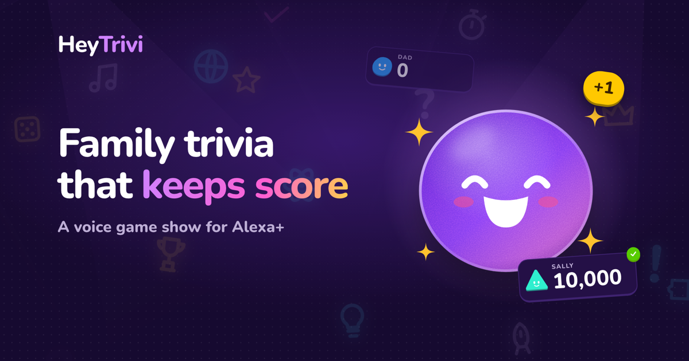
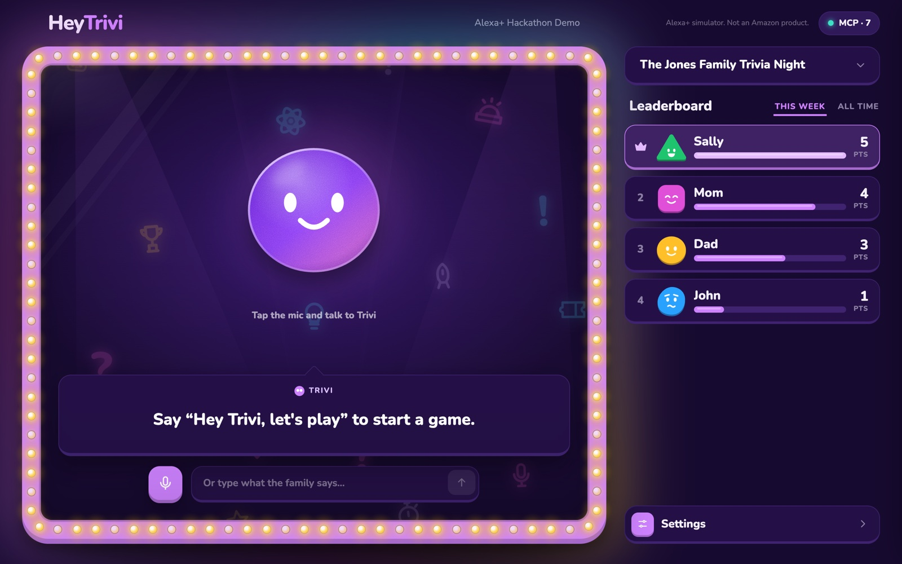
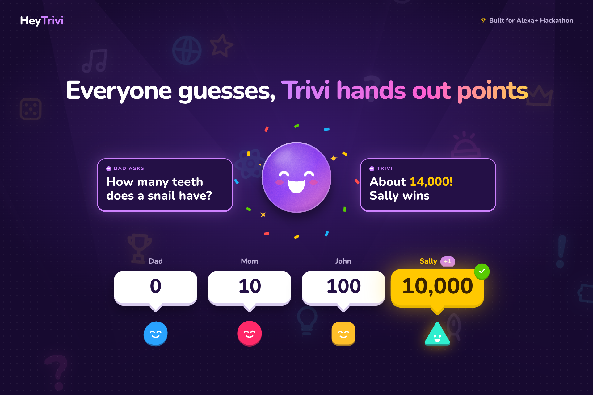
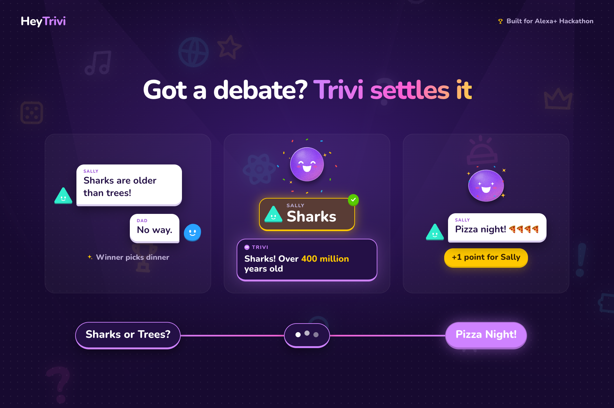
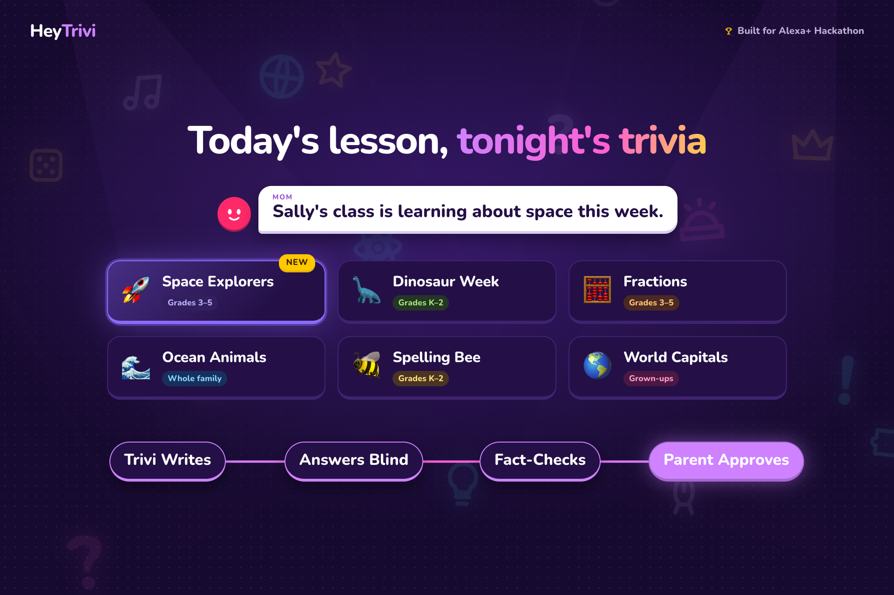
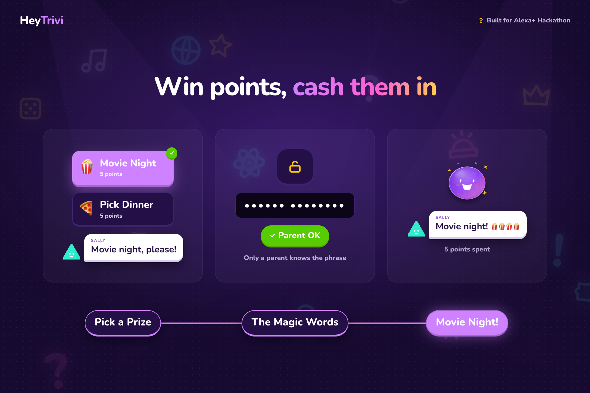
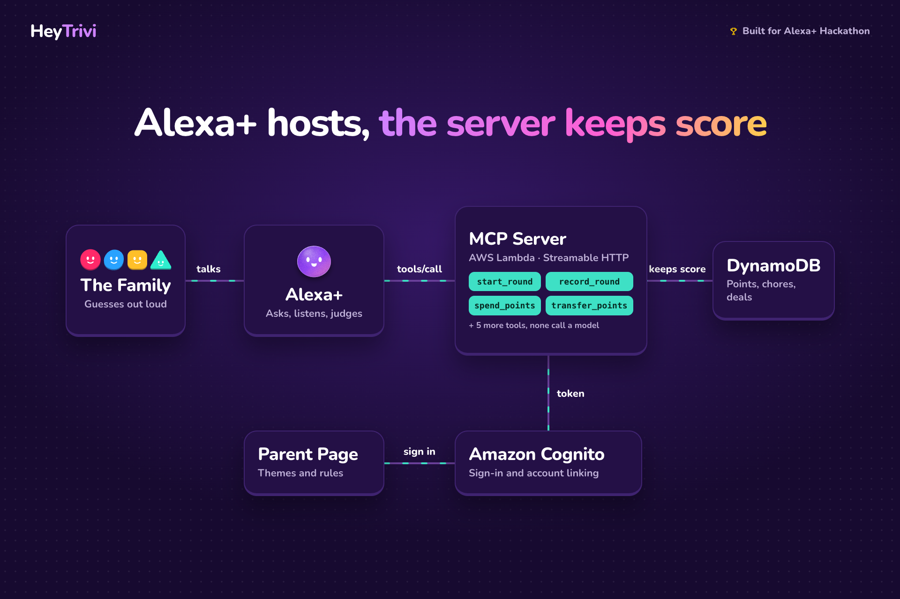
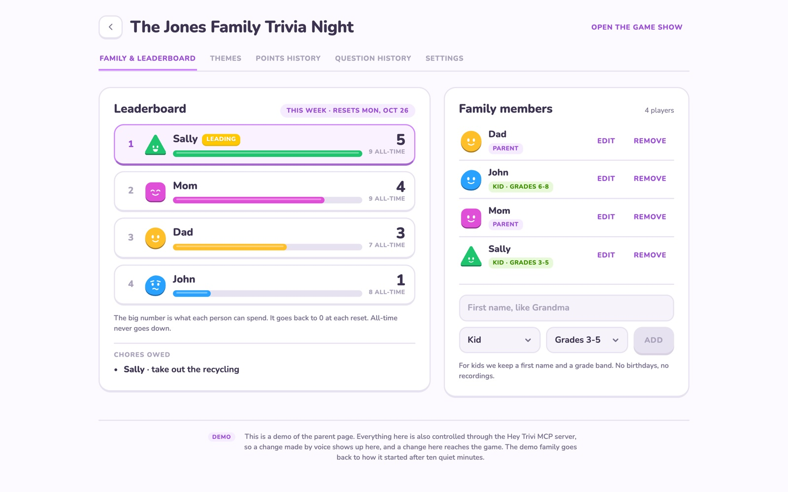
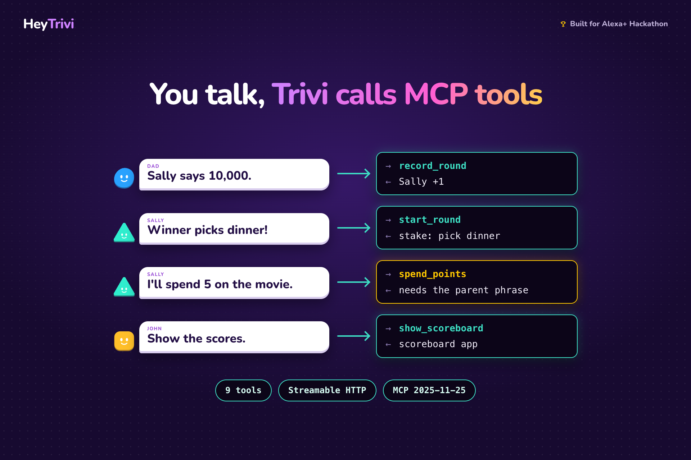

<p align="center">
  
</p>

<h1 align="center">Hey Trivi</h1>

<p align="center">
  <strong>The family game show that keeps score.</strong><br>
  A voice game for Alexa+, built as an MCP server.
</p>

<p align="center">
  <a href="LICENSE"></a>
  
  
  
  
</p>

<p align="center">
  <a href="https://heytrivi.app"><b>Website</b></a> ·
  <a href="https://heytrivi.app/demo"><b>Try the demo</b></a> ·
  <a href="https://heytrivi.app/parent"><b>Parent page</b></a> ·
  <a href="docs/devpost-overview.md"><b>Hackathon write-up</b></a>
</p>

<p align="center"><sub>Released under the <a href="LICENSE">MIT License</a>. Alexa+ simulator. Not an Amazon product.</sub></p>

---

Families use trivia and riddles to settle things: who's right, who takes out the garbage, who picks the movie. The server keeps a running family scoreboard across days, along with the chores owed and the points earned, spent, and traded.

Entry for the Amazon Developer Hackathon (Alexa+ track and the AWS Builder mini challenge).

<p align="center">
  
</p>

## How it plays

<table>
  <tr>
    <td width="50%"></td>
    <td width="50%"></td>
  </tr>
  <tr>
    <td><b>Everyone guesses, Trivi hands out points.</b> Closest answer wins, and the scoreboard carries over to tomorrow.</td>
    <td><b>Got a debate? Trivi settles it.</b> Put a chore or a choice on the line and let a question decide.</td>
  </tr>
  <tr>
    <td></td>
    <td></td>
  </tr>
  <tr>
    <td><b>Today's lesson, tonight's trivia.</b> Parents describe a theme and a helper writes, answers, and fact-checks the questions.</td>
    <td><b>Win points, cash them in.</b> Spend points on movie night or dinner picks, with a parent phrase guarding the spend.</td>
  </tr>
</table>

## How it's built

<p align="center">
  
</p>

| Path | What it is |
|---|---|
| `services/mcp-server` | The MCP server (Hono on AWS Lambda, Streamable HTTP, protocol 2025-11-25) |
| `packages/core` | Game rules as pure functions: verdicts, points, stakes, tiebreaks, spending, trading, parent phrase, resets |
| `packages/store` | Storage: one interface, DynamoDB and in-memory versions, and the demo family seed |
| `apps/simulator` | Next.js app: the Alexa+ simulator, the parent page, and the website |
| `infra` | AWS CDK app |
| `docs` | Decisions, friction log, product feedback, AWS integrations, demo script |

## Quick start (no AWS account needed)

Requires Node.js 22+ and pnpm 9+.

```bash
pnpm install
pnpm dev:local
```

To run with no AWS account at all, also start the simulator with `MOCK_MODEL=1` (see below).

The MCP server runs at `http://localhost:4787/mcp` with an in-memory store seeded with the demo family: Mom, Dad, Sally, and John.

Every request needs a bearer token. Locally, and on the demo deployment until account linking is added, use the development token:

```
Authorization: Bearer dev-token-demo
```

> [!TIP]
> **Demo parent phrase:** the demo family has a parent phrase set: **purple pancakes**. Spending points needs it. Without it, `spend_points` returns "That needs the parent phrase. Ask a parent to say it." Matching ignores case, punctuation, and extra spaces. The server stores only a salted hash of the phrase. Five wrong tries in ten minutes lock spending for ten minutes.

## The simulator

Hackathon entrants can't connect to a real Alexa+ device, so `apps/simulator` stands in for it: a speaker that listens and talks, a smart display, and a panel showing every MCP message it sends. It's a real MCP client (the official SDK, over Streamable HTTP) and works against the local or the deployed server.

In a second terminal:

```bash
pnpm --filter simulator dev
```

Open http://localhost:3000/demo in Chrome (speech recognition needs Chrome). Tap to talk, or type.

<details>
<summary><b>Simulator settings</b> (<code>apps/simulator/.env.local</code>)</summary>

| Variable | Default | What it does |
|---|---|---|
| `MCP_SERVER_URL` | `http://localhost:4787/mcp` | The MCP server to talk to |
| `MCP_DEV_TOKEN` | `dev-token-demo` | Bearer token for the demo household |
| `MOCK_MODEL` | unset | `1` runs with no model and no AWS account (see below) |
| `MODEL_PROVIDER` | `gateway` | Where the host model runs: `gateway` (Vercel AI Gateway) or `bedrock` (Amazon Bedrock directly) |
| `AI_GATEWAY_API_KEY` | unset | Key for the AI Gateway (from the Vercel dashboard, AI Gateway → API Keys) |
| `GATEWAY_MODEL_ID` | `amazon/nova-2-lite` | Host model on the gateway |
| `BEDROCK_MODEL_ID` | `us.amazon.nova-2-lite-v1:0` | Host model on Bedrock |
| `AWS_REGION` | `us-east-2` | Region for Bedrock and Polly |
| `POLLY_VOICE_ID`, `POLLY_ENGINE` | `Joanna`, `standard` | The speaker's voice |

</details>

### The host model

Both providers run the same model, Amazon Nova 2 Lite, through the AI SDK, so the prompt and tools don't change. The default is the Vercel AI Gateway because new AWS accounts get a Bedrock daily token quota of 0 for every Nova model, and that quota can't be raised from the console. The Bedrock path is still complete (the route, the IAM role in CDK, and the Amplify compute role). Set `MODEL_PROVIDER=bedrock` on an account that has Bedrock quota. See [docs/decisions.md](docs/decisions.md) #16.

### Replay scripts and mock mode

`scripts/replays` holds four scripted conversations: a one-breath round, a chore with a tiebreak, a next-day session, and a points-for-chore trade followed by a protected spend. Pick one and press **Play replay**.

With `MOCK_MODEL=1` there is no model. Each replay line carries the host's turn, which runs against the real MCP server, so the whole thing works without an AWS account. In mock mode, whatever you say or type plays the next line of the selected script, and the screen shows which line comes next, so you can play the scripts by voice.

## The parent page

<p align="center">
  
</p>

http://localhost:3000/parent is where a parent signs up, sets up the family, and manages it:

- **Family & leaderboard:** balances and all-time totals, chores owed, and adding, renaming, or removing family members.
- **Themes:** sets of questions and riddles on one topic (called packs in the code and the MCP tools). Write them by hand, or describe what you want ("my kids are 6 and 8 and learning about dinosaurs, make 6 questions and riddles") and the helper writes a draft, answers each question blind, and fact-checks it. You review and edit before saving. The family plays a theme by name: "play the dinosaur theme."
- **Points history:** every point earned, spent, traded, or reset, by day and by person.
- **Question history:** each question, everyone's answer and verdict, and what was at stake.
- **Settings:** point reset (never, weekly, monthly), time zone, reset now, the parent phrase, and the show name.

The pack helper uses Claude Haiku 5.5 and Claude Sonnet 5.5 through the AI Gateway (`AI_GATEWAY_API_KEY`); override with `PACK_WRITER_MODEL_ID` and `PACK_FACT_MODEL_ID`. With `MOCK_MODEL=1` it returns a fixed sample.

The page talks to the MCP server's `/parent` API, so it changes the same household the game plays. While a parent is signed in, the simulator plays as their family.

Every family uses the same MCP server URL. A parent's Cognito access token tells the server which household to load, and the server publishes the OAuth discovery documents (`/.well-known/oauth-protected-resource` and `/.well-known/oauth-authorization-server`) so an MCP client can link an account.

**Locally**, with no Cognito settings, sign-in is simulated: "Sign in as the demo family" or "Start a new family". The MCP server accepts these local sign-ins only when it runs with the in-memory store.

**With Cognito** (after `pnpm infra:deploy`), set these from the stack outputs in `apps/simulator/.env.local` and in the Amplify app's environment variables:

| Variable | Value |
|---|---|
| `COGNITO_DOMAIN` | `CognitoDomain` output |
| `COGNITO_CLIENT_ID` | `CognitoWebClientId` output |
| `APP_URL` | The app's public URL, for example `https://main.<app-id>.amplifyapp.com` |

The deployed MCP server gets its Cognito settings from CDK. The web client's callback URLs are the Amplify URL (`PARENT_APP_URL` at deploy time) and `http://localhost:3000`.

## MCP tools

<p align="center">
  
</p>

| Tool | When the host calls it |
|---|---|
| `get_household` | Start of every session: "Let's play Hey Trivi", "What's the score?" |
| `add_player` | "Add Grandma to the game" |
| `start_round` | "Ask us one", "quiz us", "for the garbage", "riddles", or a tiebreak |
| `record_round` | After guesses are in: "Mom says... Dad says..." |
| `complete_chore` | "John took out the garbage" |
| `spend_points` | "Sally spends 3 points to pick the movie" |
| `transfer_points` | "I'll give Sally 3 points to take the garbage for me" |
| `show_scoreboard` | "Show the scores" |
| `list_packs` | "What packs do we have?" |

## Alexa+

The same server is meant to be an Alexa+ MCP add-on: Alexa+ links a parent's Cognito account, and the family plays by voice. [docs/alexa-plus.md](docs/alexa-plus.md) maps the setup, linking, and conversation flows, lists how each Alexa+ requirement is met, and has the `alexa-ai` steps to register it. The store listing is in `alexa/addon-package/addon.json`. It isn't tested against real Alexa+, which hackathon entrants can't reach.

## Tests

```bash
pnpm test
```

This runs the game-rule unit tests, the store tests, and the MCP protocol and tool tests, all with no AWS account. To run the protocol tests against a deployed server:

```bash
TEST_MCP_URL=https://<function-url>/mcp pnpm --filter mcp-server test:protocol
```

To run the store tests against a real DynamoDB table (each test uses its own throwaway household):

```bash
AWS_REGION=us-east-2 TEST_DYNAMO_TABLE=hey-trivi pnpm --filter @hey-trivi/store test
```

Latency test (calls each tool 50 times and reports the 95th percentile; the latest report is in `docs/latency-report.txt`):

```bash
pnpm latency https://<function-url>/mcp
```

## Deploy to AWS

```bash
pnpm infra:deploy
```

The first deploy to an account and region needs a one-time `npx cdk bootstrap` from `infra/`. This deploys a DynamoDB table, the Cognito user pool for parents, and the MCP server Lambda with a function URL. The URL is printed as `McpFunctionUrl` and stored in SSM at `/hey-trivi/mcp-function-url`. See `docs/decisions.md` for the deployment region.

To tear it down:

```bash
pnpm infra:destroy
```

## Docs

| Doc | What's in it |
|---|---|
| [decisions.md](docs/decisions.md) | Why things are built the way they are |
| [alexa-plus.md](docs/alexa-plus.md) | Alexa+ setup, account linking, and conversation flows |
| [aws-integrations.md](docs/aws-integrations.md) | Each AWS service and how it's used |
| [friction-log.md](docs/friction-log.md) | What was hard along the way |
| [product-feedback.md](docs/product-feedback.md) | Feedback on the tools and platforms |
| [demo-script.md](docs/demo-script.md) | The demo video script |

## License

[MIT](LICENSE) © 2026 Hey Trivi
